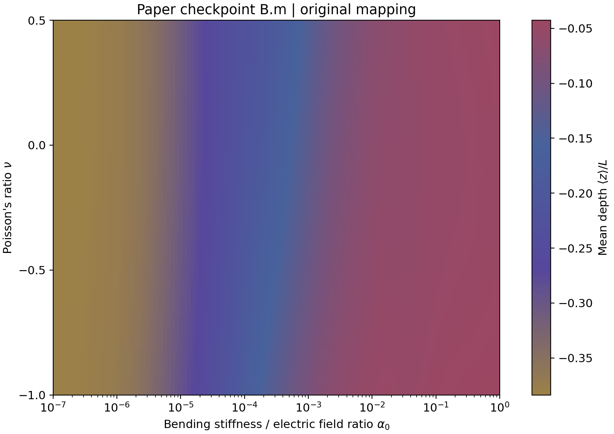
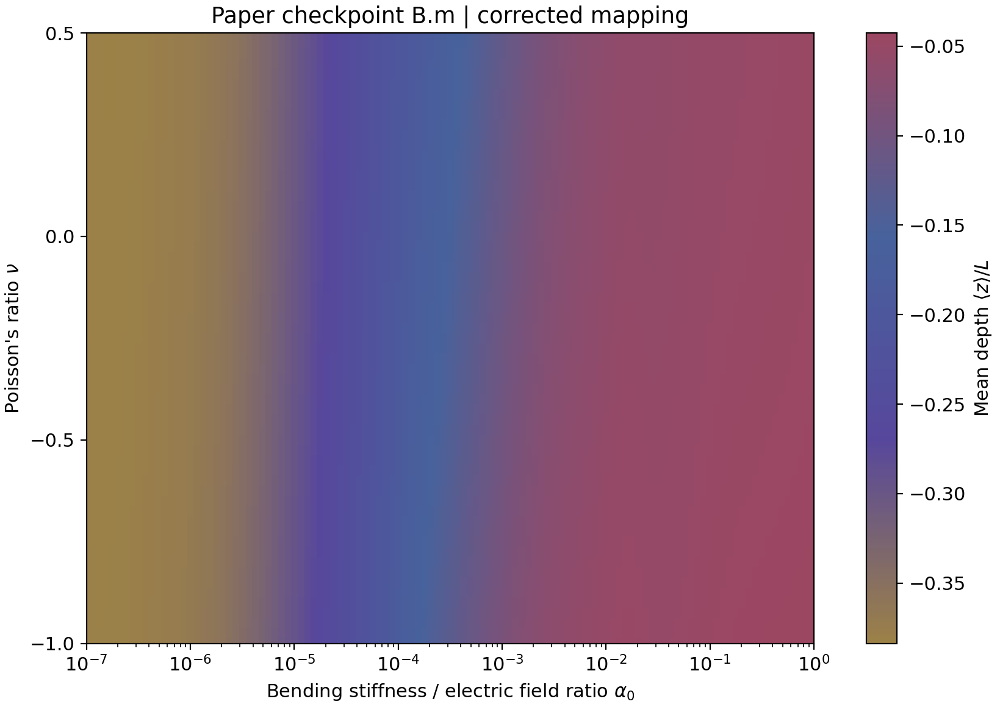

# PINN for PRE: electrospinning jet profiles

论文 **An energy-based model integrated with artificial intelligence for electrospinning jet profiles** 的 PINN 代码、已训练权重和相图数据归档。

本仓库单独保存论文相图对应的 **`model/B.m`**，包含训练代码、相图绘制与重计算代码、原始和泊松比映射修正版的 `zm.csv`。不包含后续实验的 `k4_lr1e5.m` 等权重。

## 1. 模型身份与来源界限

原始和修正版绘图脚本均加载 `model/B.m`。抽取 24 个参数点重新推理，分别复现两套 `zm` 数据：

| 数据 | 网络第三输入 | 24 点最大绝对误差 |
|---|---|---:|
| `data/original/zm.csv` | `v = ν` | 3.963×10⁻⁸ |
| `data/corrected/zm.csv` | `v = (ν − 1)/2` | 3.963×10⁻⁸ |

权重 SHA-256：

```text
feb6ad7d9870e0ddfc431f0b0ade4ccd54067382f56ce7ce4ec9531a30d1e423
```

它与原项目的 `PINNcode/model/B.m`、`PINNcode/model/B_back.m`、`nuupdate/model/B.m` 完全相同。`.m` 在这里表示 PyTorch `state_dict`，不是 MATLAB 源文件。

**来源界限：**现有证据确定了权重与相图数值数据的对应关系；尚不能确定论文最终拼版 JPG 使用了哪套泊松比映射，也不能确定 `B.m` 的全部历史训练超参数、轮数或优化器状态。提供的训练代码是现存脚本归档，不保证从头训练即可逐位重建 `B.m`。数值复现检验不等于方程残差或物理精度验收。

## 2. 文件结构

```text
pinn_for_PRE/
├── README.md
├── requirements.txt
├── model.py                    # 与 B.m 兼容的硬边界约束网络
├── physics.py                  # 原训练脚本的 9 项残差和损失表达式
├── train.py                    # 可控制轮数、初始权重、输出路径的训练入口
├── plot_phase.py               # 从 zm 出图、抽样核验、从权重重计算
├── model/B.m                   # 论文对应权重，约 7.4 MiB
├── data/
│   ├── original/zm.csv          # 原始映射，129×61，负的平均深度
│   └── corrected/zm.csv         # 修正映射，129×61，负的平均深度
├── figures/                    # 两套相图预览 PNG/PDF 及元数据 JSON
├── archive/
│   ├── pinnB_400points.py       # 原项目 PINNcode/pinnB.py，逐字保留
│   ├── pinnB_100points.py       # 原项目 nuupdate/pinnB.py，逐字保留
│   ├── MeanThetaphase2.py       # 原始绘图脚本，逐字保留
│   └── MeanThetaphase2_corrected.py
└── provenance/
    ├── source_manifest.json    # 原始相对路径与 SHA-256
    ├── model_identification.json
    └── validation.json         # 已完成检查和实际运行环境
```

`outputs/` 为运行生成目录，不纳入 Git。`archive/` 用于溯源；日常运行使用仓库根目录的入口。

## 3. 安装

推荐 Python 3.10，CPU 即可运行；当前整理版本使用 CPU，没有新增 GPU 训练入口。

```bash
git clone https://github.com/GazerJ/pinn_for_PRE.git
cd pinn_for_PRE
python3 -m venv .venv
source .venv/bin/activate
python -m pip install -r requirements.txt
```

已验证 Python 3.10、PyTorch 2.1.1；完整版本见 `provenance/validation.json`。现代入口只依赖 PyTorch、NumPy、Matplotlib 和 SciPy，不要求 LaTeX 或 SciencePlots。

历史绘图脚本另有 SciencePlots、LaTeX 和原工作目录文件依赖，不能视为本仓库的独立运行入口。

## 4. 用归档数据绘制相图

无需重新训练或推理，通常数秒完成：

```bash
python plot_phase.py --mapping original
python plot_phase.py --mapping corrected
```

输出为 `outputs/phase_original.png/pdf/json` 和 `outputs/phase_corrected.png/pdf/json`。

原始映射：



修正映射：



两张图使用相同色限。新入口复现平均深度色图，未重绘论文拼版、轨迹小图、区域文字或拟合交叉边界；字体和布局不宣称与论文图片逐像素一致。

### 配色和色限

论文相图自定义四色渐变（低值到高值）：

```text
#9C8147 → #57479C → #47629C → #9C4762
棕黄       紫          蓝          玫瑰红
```

统一色限取原始数据按历史脚本处理后的最小和最大值：

```text
vmin = -0.3836963102221489
vmax = -0.042613446712493896
```

色条刻度为 −0.35、−0.30、…、−0.05；刻度不等于实际端点。处理使用 4×4 均值卷积（SciPy 默认 reflect 边界），再显示行索引 0–112，对应 `α₀=10⁻⁷…1`。这是依据现存原始数据和脚本恢复的色限，不代表已从拼版 JPG 提取到完整制图元数据。

## 5. 从权重验证或重计算

快速核验六个 α₀ 行与四个 ν 列，共 24 点；最大绝对误差超过 `1e-6` 会退出并报错：

```bash
python plot_phase.py --mapping original --verify
python plot_phase.py --mapping corrected --verify
```

重新计算完整 **129×61** 网格，CPU 需要数分钟，取决于硬件：

```bash
python plot_phase.py --mapping original --verify --recompute
python plot_phase.py --mapping corrected --verify --recompute
```

另存 `outputs/zm_original_recomputed.csv` 或 `outputs/zm_corrected_recomputed.csv`，不覆盖归档数据。

| 项目 | 定义 |
|---|---|
| `zm.csv` | 空白符分隔的纯数字文本，无表头，用 `numpy.loadtxt` 读取 |
| 行索引 | `i=0,…,128` |
| 网络第二输入 | `a=(i−112)×0.125` |
| 弯曲刚度参数 | `α₀=10^(a/2)`，完整数据范围 `10⁻⁷…10` |
| 列索引 | `j=0,…,60` |
| 泊松比 | `ν=0.025j−1`，范围 `−1…0.5` |
| 蒸发参数 | `k=4` |
| 初始切向极角 | `Tθ(0)=π/2` |
| 弧长网格 | `s=0,0.001,…,0.999` |
| 深度重建 | `t_z=cos(Tθ)`，`z_i=0.001×sum(t_z[:i])` |
| 存储值 | 对 `z_i` 取算术平均，保留负号；归一化长度 `L=1` |

重计算保留历史脚本的浮点前缀求和方式，以便核验。

### 泊松比映射

现存训练代码 `β₀=α₀/[2(1+v)]`，论文圆截面定义 `α₀/β₀=1+ν`，因此修正版使用 `v=(ν−1)/2`，原始版本保留 `v=ν`。

现存训练脚本采样 `v∈[0,1]`、`a∈[−8,0]`；修正版物理区间对应 `v∈[−1,−0.25]`，超出现存脚本的采样范围；图中 `α₀<10⁻⁴` 也超出该 `a` 范围。当前脚本采样与论文相图区间存在差异，不能据此反推归档 `B.m` 的完整历史训练范围。

## 6. 训练

先做两轮短程检查：

```bash
python train.py --epochs 2 --points 100 --init model/B.m --log-every 1 \
  --output outputs/smoke/B-trained.m
```

使用现存 400 点脚本的默认采样与优化器设置从头训练：

```bash
python train.py --output outputs/training/from_scratch.m
```

从归档权重初始化，再开始一段训练：

```bash
python train.py --init model/B.m --epochs 20000 --lr 1e-5 \
  --output outputs/training/from_paper_lr1e5.m
```

最后一个命令的学习率是显式选择的后续实验参数，不是 `B.m` 历史学习率的证明。`--init` 只加载网络权重，不恢复 Adam 状态或轮数，因此不是完整优化器断点续训。

| 参数 | 默认值 |
|---|---|
| 网络 | 输入 5，隐藏层 `800×4`、Tanh，输出 8 |
| 输入 | `[s,a,v,k,Tθ(0)]` |
| 输出 | `[θ,φ,Tθ,Tφ,λx,λy,λz,λτ]` |
| 采样点 | 400 / 轮 |
| 最大轮数 | 600000 |
| 学习率 | `1e-10×sqrt(npoints)`，400 点时为 `2e-9` |
| 优化器 | Adam，`amsgrad=True`，`weight_decay=0` |
| 随机种子 | 43 |
| γ₀ | 100 |
| 采样 | `s∈[0,1]`，`a∈[−8,0]`，`v∈[0,1]`，`k∈[0,4]`，`Tθ(0)∈[π/2,5π/8]` |
| 早停 | 最佳残差评分 `<5e-5` |

`physics.py` 保留原始方程和损失表达式，可学习的 `sigma` 参数沿用历史实现。训练损失 `loss` 与残差评分 `score` 是不同指标。

现代入口增加参数控制、非有限值检查、元数据输出和独立的最佳权重副本。它禁止覆盖 `model/B.m`，拒绝覆盖已有输出；默认不加载 `B-test.m`，不执行历史脚本的 `cp B.m B_back.m` 副作用。

两份原训练脚本均完整保留，其采样点数不同；无法确定哪个版本及哪些历史修改产生了 `B.m`，不将文件修改时间作为训练来源证明。

## 7. 来源与验证记录

- `provenance/source_manifest.json`：归档文件原路径与 SHA-256。
- `provenance/model_identification.json`：五个候选权重的 24 点比较结果；其他候选权重不纳入本仓库。
- `provenance/validation.json`：运行环境及已完成检查。
- `figures/phase_*.json`：预览图配色、色限、映射、数值核验结果。

本次整理验证：Python 编译检查；两套数据各 24 点复现；两套 PNG/PDF 出图；从 `B.m` 初始化的 2 轮、100 点训练，损失有限且能保存检查点。没有在本次整理中执行完整 60 万轮训练或重算全部相图网格。
