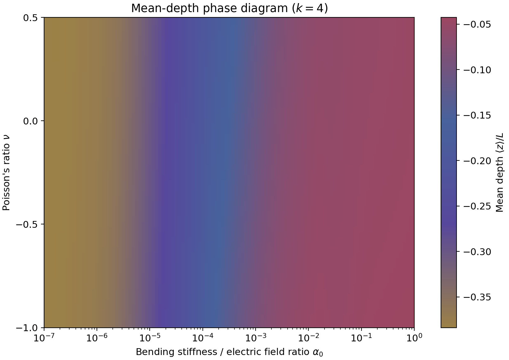

# PINN for PRE

使用物理信息神经网络（PINN）求解静电纺丝射流的三维形态，并绘制平均深度相图。模型以带电弹性曲线描述射流，包含外电场、弯曲弹性、扭转弹性和自发曲率。

## 安装

推荐 Python 3.10。

```bash
git clone https://github.com/GazerJ/pinn_for_PRE.git
cd pinn_for_PRE
python3 -m venv .venv
source .venv/bin/activate
python -m pip install -r requirements.txt
```

运行依赖 PyTorch、NumPy、Matplotlib 和 SciPy，使用 CPU，不需要 LaTeX。

## 项目结构

```text
pinn_for_PRE/
├── model.py          网络结构与硬边界约束
├── physics.py        控制方程与损失函数
├── train.py          训练入口
├── plot_phase.py     相图绘制与数据计算
├── requirements.txt  Python 依赖
├── model/B.m         预训练网络权重
├── data/zm.csv       平均深度数据
└── figures/          相图 PNG、PDF 与参数记录
```

`model/B.m` 是 PyTorch `state_dict`。训练与计算输出默认写入 `outputs/`。

## 网络与参数

网络输入为 `[s,a,v,k,Tθ(0)]`，四个隐藏层各含 800 个神经元，使用 Tanh 激活，输出 `[θ,φ,Tθ,Tφ,λx,λy,λz,λτ]`。输出变换直接满足初始角度和末端乘子边界条件。

参数关系为

\[
\alpha_0=10^{a/2},\qquad
\beta_0=\frac{\alpha_0}{2(1+v)},\qquad
v=\frac{\nu-1}{2}.
\]

其中 \(\nu\) 为泊松比，\(k\) 控制沿射流方向的材料参数变化，归一化长度 \(L=1\)。

## 损失函数

加权训练损失为

\[
\mathcal L=\sum_{i=1}^{9}
\left[\frac{E_i}{A_i}+\log A_i\right],
\qquad A_i=\sigma_i^2+10^{-9},
\]

其中 \(\sigma_i\) 为可训练参数。日志中的 `score` 为

\[
\mathrm{score}=\operatorname{mean}(E_i)
+\operatorname{std}(E_i)+\max(E_i),
\]

标准差使用 PyTorch 默认的样本标准差。`loss` 含对数项，可以为负；`score` 为非负残差评分。

## 训练

短程运行：

```bash
python train.py --epochs 2 --points 100 --init model/B.m --log-every 1 \
  --output outputs/smoke/B-trained.m
```

从头训练：

```bash
python train.py --output outputs/training/from_scratch.m
```

从预训练权重初始化：

```bash
python train.py --init model/B.m --epochs 20000 --lr 1e-5 \
  --output outputs/training/B-trained.m
```

`--init` 加载网络权重，优化器重新初始化。程序保护 `model/B.m`，并拒绝覆盖已有训练输出。

默认训练采样为 \(s\in[0,1]\)、\(a\in[-8,0]\)、\(v\in[0,1]\)、\(k\in[0,4]\)、\(T_\theta(0)\in[\pi/2,5\pi/8]\)。绘图时指定的参数可能超出默认训练采样范围。

## 绘制相图

使用提供的数据：

```bash
python plot_phase.py
```

从权重重新计算数据并绘图：

```bash
python plot_phase.py --recompute
```

使用指定权重计算：

```bash
python plot_phase.py --recompute --checkpoint outputs/training/B-trained.m
```

输出为 `outputs/phase.png`、`outputs/phase.pdf` 和 `outputs/phase.json`。重计算的数据保存为 `outputs/zm.csv`，不覆盖项目提供的数据。



相图颜色表示平均深度 \(\langle z\rangle/L\)，横轴为 \(\alpha_0\)，纵轴为 \(\nu\)，固定 \(k=4\)、\(T_\theta(0)=\pi/2\)。配色为 `#9C8147 → #57479C → #47629C → #9C4762`，色限为 `[-0.3836963102221489, -0.042613446712493896]`。

## 数据格式

`data/zm.csv` 是无表头、空白符分隔的 `129×61` 数组，可通过 `numpy.loadtxt` 读取。

| 项目 | 定义 |
|---|---|
| 行索引 | `i=0,…,128` |
| 网络输入 | `a=(i−112)×0.125` |
| 弯曲刚度参数 | `α₀=10^(a/2)`，完整范围 `10⁻⁷…10` |
| 列索引 | `j=0,…,60` |
| 泊松比 | `ν=0.025j−1`，范围 `−1…0.5` |
| 网络第三输入 | `v=(ν−1)/2` |
| 弧长采样 | `s=0,0.001,…,0.999` |
| 深度 | `z_i=0.001×sum(cos(Tθ)[:i])` |
| 数据值 | `z_i` 的算术平均，保留符号 |

绘图使用 4×4 均值卷积，显示行索引 0–112，即 \(\alpha_0\in[10^{-7},1]\)。

提供的 `B.m` 与 `zm.csv` 可直接用于推理和绘图；运行训练命令会生成使用上述损失函数优化的新权重。
